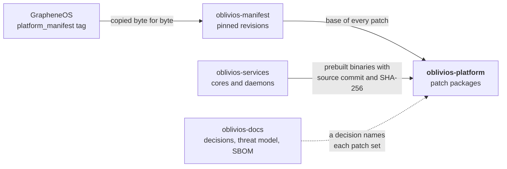
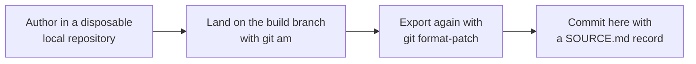

<p align="center">
  <a href="https://oblivios.org">
    <picture>
      <source media="(prefers-color-scheme: dark)" srcset="https://oblivios.org/brand/lockup-dark.svg">
      
    </picture>
  </a><br>
  <a href="https://oblivios.org">oblivios.org</a>
</p>

<h1 align="center">oblivios-platform</h1>

<p align="center">
  <strong>The patches and packages that turn pinned GrapheneOS source into ObliviOS.</strong><br>
  Privacy controls, a decoy unlock, a password manager and device integration, kept as small, documented patches on top of upstream.
</p>

<p align="center">
  
  
  
</p>

> **Stage: source only.** This repository publishes source, records and a bill of materials. No build, image or update
> service is offered and no device is supported ([ADR-171](https://github.com/Beau4201/oblivios-docs/blob/main/docs/governance/decision-log.md)).
> Nothing here is a finished product or a security guarantee; each package says what was tested and what was not.

## What this is

ObliviOS is an Android distribution based on [GrapheneOS](https://grapheneos.org). This repository holds everything ObliviOS
adds to the GrapheneOS source tree, organised as **patch packages**. A package is a directory with `git format-patch` files for
one or more upstream projects, its own source files (apps, tools, tests), and a provenance record that says what each patch does,
why it differs from upstream, and how it was checked.

It does not contain a GrapheneOS or AOSP source tree (patches carry their context lines, and 40 AOSP files of the DeviceSettings
contract are vendored; `NOTICE` lists them), no build output, no vendor blobs, no signing material and no device logs.

## How the repositories fit together



| Repository | Holds |
| --- | --- |
| [`oblivios-manifest`](https://github.com/Beau4201/oblivios-manifest) | The pinned GrapheneOS and AOSP revisions the patches apply to, and how each baseline was chosen. |
| **`oblivios-platform`** | This repository: the patch packages. |
| [`oblivios-services`](https://github.com/Beau4201/oblivios-services) | The platform-independent logic and native daemons that some packages ship as prebuilt binaries. |
| [`oblivios-docs`](https://github.com/Beau4201/oblivios-docs) | The decision log, threat model, capability boundaries and the software bill of materials of all four repositories. |

## Packages

There are 19 patch packages (as of 2026-11-17). Each has a `README.md` or `SOURCE.md` with its provenance, its patches and the
decisions behind them.

### Privacy and network

| Package | What it does |
| --- | --- |
| [`privacy/compartments-profiles`](privacy/compartments-profiles/README.md) | The profiles of Compartments: a policy store, sensor modes and persona data, with host-checked cores (ADR-208). |
| [`privacy/exit`](privacy/exit/README.md) | The per-app network exit of Compartments: the `exitd` daemon, the exit app, SELinux domains and a resolver-cache patch (ADR-178, ADR-184). |
| [`privacy/identity-surface`](privacy/identity-surface/README.md) | Five patches that reduce the unit-specific values apps can read or derive: boot properties, sensor bias estimates, EUI-64 addresses (ADR-167, ADR-173). |
| [`privacy/linkability`](privacy/linkability/README.md) | Fourteen patches that close listed channels through which two apps of one user can link themselves to one device: loopback, clipboard, settings tables, vibrator calibration (ADR-174). |
| [`privacy/screenshot-detection`](privacy/screenshot-detection/README.md) | One patch that stops the system from telling apps that the user took a screenshot. |

### Duress Unlock and passwords

| Package | What it does |
| --- | --- |
| [`credential/duress-unlock-dummy`](credential/duress-unlock-dummy/README.md) | Stage 1: a dummy credential check that costs what a real one costs, so a failed attempt does not reveal whether a decoy exists (ADR-040). |
| [`credential/duress-unlock-decoy`](credential/duress-unlock-decoy/README.md) | Stage 2: the decoy mechanism: a decoy user type, a silent switch, routing state, the keyguard hook and the Settings flow (ADR-053 onward). |
| [`passwords`](passwords/SOURCE.md) | The Passwords app and the prebuilt Rust core of its vault (ADR-185). |

### Data Map, interface and device

| Package | What it does |
| --- | --- |
| [`datamap`](datamap/README.md) | The Live Data Map: a collector in `system_server`, a classifier, address data and the app (ADR-157). |
| [`airpods`](airpods/README.md) | AirPods support: the app, the prebuilt codec jar and the Bluetooth patches. |
| [`keyboard/autofill-chips`](keyboard/autofill-chips/README.md) | Logins of the Passwords app as chips in the suggestion strip of the on-screen keyboard. |
| [`keyboard/restyle`](keyboard/restyle/README.md) | The restyle of the on-screen keyboard. |
| [`launcher/app-drawer`](launcher/app-drawer/README.md) | The app drawer with themed icons and automatic category groups. |
| [`branding/boot`](branding/boot/README.md) | The boot picture: reproducible textures and three patches for `frameworks/base` and `build/make` (ADR-152). |

### Memory, physical protection and release

| Package | What it does |
| --- | --- |
| [`memory/cached-process-cap`](memory/cached-process-cap/SOURCE.md), [`memory/decoy-stop-on-switch`](memory/decoy-stop-on-switch/SOURCE.md), [`memory/zram-size`](memory/zram-size/SOURCE.md) | Memory settings of the image (records and patches). |
| [`physical/grab-detection`](physical/grab-detection/README.md) | Patches that are meant to lock the phone when it is pulled out of a hand in use and restart it after 60 seconds without a PIN (ADR-169). Tuned on a few recorded grabs on one device. |
| [`release/ota-server-url`](release/ota-server-url/README.md) | Points the Updater app at the owner's private OTA server. The published patch carries a placeholder host (ADR-245, ADR-246). |

## How a package is built

Every package is a set of patches plus the files that belong to them, and the patches follow one discipline
([`CONTRIBUTING.md`](CONTRIBUTING.md)):



A patch file is never edited by hand: a fix is a new landed commit, exported again, so the hash and the provenance chain stay
intact. No patch is added without a decision record that names it.

```text
<area>/<package>/
├── README.md            what the package is, where it stands
├── SOURCE.md            base revision, one row per patch, how it was verified and what was not
└── patches/<project>/   NNNN-*.patch for one upstream project, in apply order
```

Nothing in this repository builds on its own. The patches apply to a GrapheneOS tree at the revisions pinned in
`oblivios-manifest`, with `git am` in the order the package's `SOURCE.md` gives. The builds of the project were made on private
hosts that are not part of this repository.

## Verify

- **Host checks.** Several packages carry tests that run on a workstation; the Java ones need only a JDK, some C++ ones need
  an AOSP tree. For example, `privacy/compartments-profiles/system-server/test/run.sh` prints one `ok N checks` line per test class.
- **Prebuilt binaries.** Four files are committed as binaries because the AOSP build does not build them
  (`airpods/core/airpods-core.jar`, `passwords/core/arm64/libvault_core.so`, `privacy/exit/daemon/arm64/exitd`,
  `datamap/app/res/raw/land.bin`). Each has a record with its source, toolchain, build command and SHA-256, and
  `privacy/exit/daemon/check-prebuilt.sh` and `passwords/core/check-prebuilt.sh` compare a binary with its recorded hash. The licence
  texts of the Rust packages behind the two Rust binaries are in a `THIRD-PARTY-LICENSES.txt` in the directory of each package.
- **Bill of materials.** `oblivios-docs` holds a CycloneDX 1.6 and an SPDX 2.3 document with a SHA-256 for every file of the four
  repositories. Its build fails when a licence, a hash, a commit or a number in a `NOTICE` file is not supported.

## What is and is not claimed

- Each `SOURCE.md` separates what was **built**, what was **tested on a device** and what was **not verified**. A change that
  compiled is not a change that works.
- No package promises that an adversary cannot detect or defeat a feature. The threat model in `oblivios-docs` lists residual
  risks, including that publishing this source shows an informed adversary that Duress Unlock exists.
- Development has used a Pixel 7a (`lynx`) and a Pixel 10a (`stallion`). Neither is a supported device.

## Notes on the records

A record cited by path in a README, a `SOURCE.md` or a patch (for example `docs/superpowers/...` or "the foundation repository")
may be in a private repository and not published. The decisions are in the decision log of `oblivios-docs`. The project was named
AegisOS, SovereignOS and FreeholdOS before ObliviOS (the rename is ADR-224); records written under those names keep them.

## Security

Do not open a public issue for a vulnerability. See [`SECURITY.md`](SECURITY.md) for the contact, the PGP key and what to expect.

## Contributing

Issues can be opened where the host enables them. Pull requests are not accepted yet. [`CONTRIBUTING.md`](CONTRIBUTING.md) explains how
a package is laid out and the rules for a patch.

## Licence

Apache-2.0, see [`LICENSE`](LICENSE) and [`NOTICE`](NOTICE). Each patch keeps the licence of the upstream file it modifies; `NOTICE`
lists them, with the third-party data and prebuilt binaries.

The name ObliviOS and its logo are not licensed. ObliviOS is based on GrapheneOS; it is not affiliated with or endorsed by the
GrapheneOS project.
